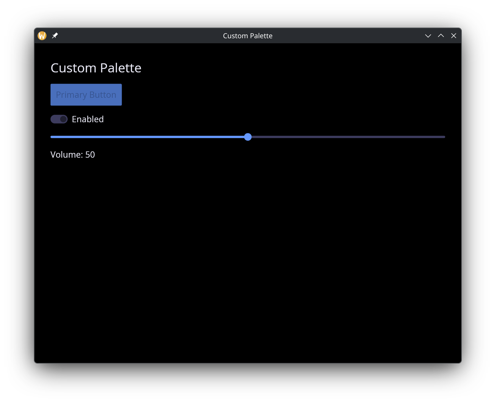
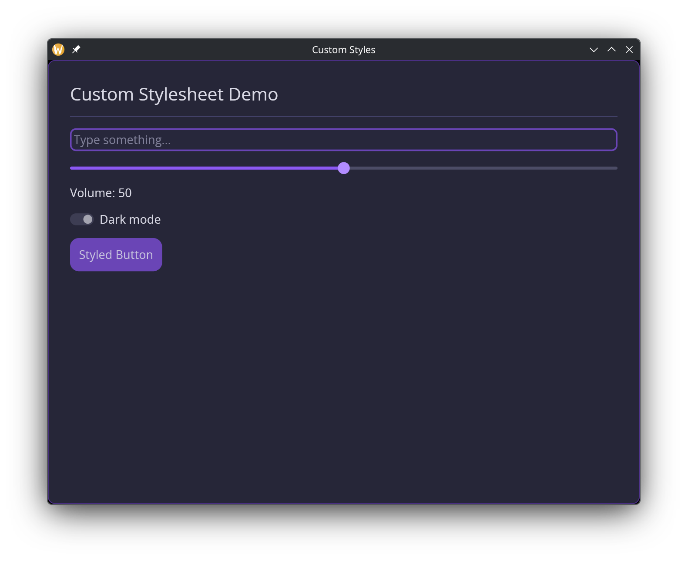

# Theming

Every GUI window accepts a `#theme` parameter that controls the visual appearance of all widgets inside it. Graphix provides 22 built-in themes, plus two mechanisms for full customization: custom palettes and custom stylesheets.

## Built-in Themes

The `Theme` type enumerates all available themes:

```graphix
{{#include ../../../../stdlib/graphix-package-gui/src/graphix/mod.gxi:theme}}
```

Apply a theme by passing it to the `window` function:

```graphix
window(#theme: &`CatppuccinMocha, &content)
```

Since `#theme` takes a `&Theme`, you can change the theme reactively:

```graphix
let dark = true;
let theme = select dark {
  true => `Dark,
  false => `Light
};

window(#theme: &theme, &content)
```

## Custom Palettes

For quick color customization without defining per-widget styles, use `` `CustomPalette `` with a `Palette`:

```graphix
{{#include ../../../../stdlib/graphix-package-gui/src/graphix/style.gxi:palette}}
```

The palette defines the core colors from which iced derives all widget styles automatically:

- `background` -- window and container backgrounds.
- `text` -- default text color.
- `primary` -- accent color for buttons, sliders, a toggled-on toggler, active elements.
- `success` -- color for success states.
- `danger` -- color for destructive actions and error states.
- `warning` -- color for warning indicators.

```graphix
{{#include ../../examples/gui/custom_palette.gx}}
```



## Custom Stylesheets

For full control over individual widget appearances, use `` `Custom(StyleSheet) ``. A stylesheet combines a palette with optional per-widget style overrides:

```graphix
{{#include ../../../../stdlib/graphix-package-gui/src/graphix/style.gxi:stylesheet_type}}
```

Every widget style field is optional (union with `null`). When `null`, the widget inherits its style from the palette automatically.

### The `stylesheet` Builder

The palette, the stylesheet and every per-widget style type and builder live in the `gui::style` module (`use gui::style::{Palette, stylesheet, button_style}`). Use the `stylesheet` function to construct a `StyleSheet` without filling in every field manually. Only `#palette` is required; all widget style parameters default to `null`:

```graphix
{{#include ../../../../stdlib/graphix-package-gui/src/graphix/style.gxi:stylesheet}}
```

Example with a custom palette and button override:

```graphix
{{#include ../../examples/gui/custom_styles.gx}}
```



## Per-Widget Style Types

Each widget style type is a struct where every field is optional (`[T, null]`). A `null` field means "inherit from the theme palette." The `gui::style` module provides both the types and corresponding builder functions: `gui::style::button_style`, not `gui::button_style`.

### ButtonStyle

```graphix
{{#include ../../../../stdlib/graphix-package-gui/src/graphix/style.gxi:button_style_type}}
{{#include ../../../../stdlib/graphix-package-gui/src/graphix/style.gxi:button_style}}
```

### TextInputStyle

```graphix
{{#include ../../../../stdlib/graphix-package-gui/src/graphix/style.gxi:text_input_style_type}}
{{#include ../../../../stdlib/graphix-package-gui/src/graphix/style.gxi:text_input_style}}
```

### SliderStyle

```graphix
{{#include ../../../../stdlib/graphix-package-gui/src/graphix/style.gxi:slider_style_type}}
{{#include ../../../../stdlib/graphix-package-gui/src/graphix/style.gxi:slider_style}}
```

### Other Widget Styles

The remaining widget style types follow the same pattern -- a struct of optional fields with a corresponding builder function:

| Type | Builder | Key Fields |
|------|---------|------------|
| `CheckboxStyle` | `checkbox_style` | `accent`, `background`, `border_color`, `border_radius`, `border_width`, `icon_color`, `text_color` |
| `ContainerStyle` | `container_style` | `background`, `border_color`, `border_radius`, `border_width`, `text_color` |
| `MenuStyle` | `menu_style` | `background`, `border_color`, `border_radius`, `border_width`, `selected_background`, `selected_text_color`, `text_color` |
| `PickListStyle` | `pick_list_style` | `background`, `border_color`, `border_radius`, `border_width`, `handle_color`, `placeholder_color`, `text_color` |
| `ProgressBarStyle` | `progress_bar_style` | `background`, `bar_color`, `border_radius` |
| `RadioStyle` | `radio_style` | `background`, `border_color`, `border_width`, `dot_color`, `text_color` |
| `RuleStyle` | `rule_style` | `color`, `fill_percent` (the share of the container the line covers, 0 to 100), `radius` |
| `ScrollableStyle` | `scrollable_style` | `background`, `border_color`, `border_radius`, `border_width`, `scroller_color` |
| `TextEditorStyle` | `text_editor_style` | `background`, `border_color`, `border_radius`, `border_width`, `placeholder_color`, `selection_color`, `value_color` |
| `TogglerStyle` | `toggler_style` | `background`, `background_border_color`, `border_radius`, `foreground`, `foreground_border_color`, `text_color` |

All builder functions accept the same labeled arguments as the corresponding struct fields, all optional, all defaulting to `null`.
