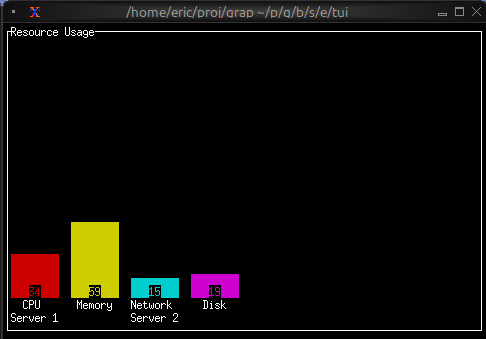

# The Bar Chart Widget

<!-- CR claude for claude: [doc-drift/low] Bars are vertical only by default:
`#direction: &`Horizontal` lays them out sideways. The parameter list also leaves out
`#direction`, `#bar_style`, `#label_style` and `#value_style` (bar_chart) and
`#value_style` (bar), all in barchart.gxi. Mention them. Found by reading; not run.
(book-ui-b-09) -->
The `bar_chart` widget displays categorical data as vertical bars, supporting grouped bars, custom styling, and dynamic updates. It's ideal for comparing values across categories, showing rankings, or displaying resource usage.

## Interface

```graphix
{{#include ../../../../stdlib/graphix-package-tui/src/graphix/barchart.gxi}}
```

## Parameters

### bar_chart
- **max** - Maximum value for chart scale (auto-scales if not specified)
- **bar_width** - Width of each bar in characters
- **bar_gap** - Space between bars within a group
- **group_gap** - Space between bar groups
- **style** - Base style for the chart

### bar_group
- **label** - Line labeling the group (displayed below bars)

### bar
- **style** - Style for the bar
- **label** - Line labeling the bar
- **text_value** - String displayed above the bar (defaults to the numeric value)

## Examples

### Basic Usage

```graphix
{{#include ../../examples/tui/barchart_basic.gx}}
```


### Grouped Bars with Dynamic Data

```graphix
{{#include ../../examples/tui/barchart_grouped.gx}}
```



### Color-coded Values

```graphix
{{#include ../../examples/tui/barchart_colored.gx}}
```


## See Also

- [chart](chart.md) - For continuous data visualization
- [sparkline](sparkline.md) - For compact trend display
- [gauge](gauge.md) - For single value display
