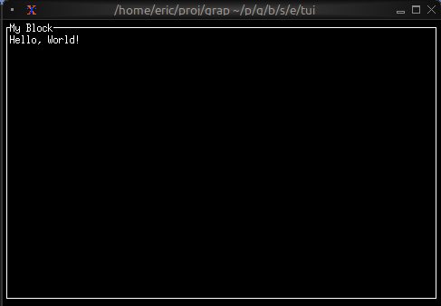

# The Block Widget

The `block` widget is a container that wraps other widgets with optional borders, titles, and styling. It's one of the most commonly used widgets for creating structured layouts and visually separating different sections of your TUI.

## Interface

```graphix
{{#include ../../../../stdlib/graphix-package-tui/src/graphix/block.gxi}}
```

## Parameters

- **border** - Which sides have a border: `` `All ``, `` `None ``, or an array of sides, e.g. `` &[`Top, `Left] `` (one side alone is still an array, `` &[`Top] ``)
- **border_style** - Style for the border
- **merge_borders** - Strategy for merging borders of adjacent blocks: `Replace`, `Exact`, or `Fuzzy`
- **title** - Line displayed at the top of the block
- **title_bottom** - Line displayed at the bottom of the block
- **style** - Style for the block's interior
<!-- CR claude for claude: [doc-drift/low] The block reports the area inside its borders
and padding (`block.inner(rect)` in block.rs draw), not its rendered size: in a 40x10
terminal a bordered block reports 38x8, and the tui test
a_zero_area_is_reported_on_the_first_draw pins it. A reader who subtracts the borders
from this size subtracts them twice. Say it is the area the child is drawn in, as
browser.md already does. scroll.md's '**size** (output) - Rendered size of the scrollbar
area' has the same drift: ScrollbarW::draw reports the rectangle left after the bar's
row or column. probe: design/review-2026-11-16/repro/book-ui-a-block-size-is-inner.sh
(book-ui-a-01) -->
- **size** (output) - Rendered size of the block; pass `&mut size` where `size: tui::Size`

## Examples

### Basic Usage

```graphix
{{#include ../../examples/tui/block_basic.gx}}
```



### Focus Indication

Use dynamic styling to show which block has focus; Tab moves it:

```graphix
{{#include ../../examples/tui/block_focus.gx}}
```

<!-- CR claude for claude: [doc-drift/low] Five TUI screenshots show older versions of
their examples. This one has a single "Block 1 / Content here" block, but block_focus.gx
now draws two panes that Tab switches. scroll.md's scroll_list.png shows five
unhighlighted items (the example has 30, with the selection highlighted). paragraph.md's
paragraph_scrollable.gif shows one wrapped paragraph (now 60 numbered lines).
scroll.md's scroll_paragraph.gif shows "Very long text content..." (now 100 numbered
lines). paragraph_log_viewer.gif shows a real syslog line from the author's host (the
example now publishes a simulated log). Re-capture the five and drop the syslog image.
Found by comparing each image with the example run in a terminal. (examples-tui-05) -->


### Dynamic Titles

Titles can contain reactive values that update automatically:

```graphix
{{#include ../../examples/tui/block_dynamic_title.gx}}
```


## See Also

- [layout](layout.md) - For arranging multiple blocks
- [paragraph](paragraph.md) - Common content for blocks
- [text](text.md) - For creating styled text content
