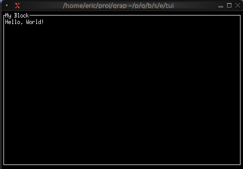

# The Block Widget

The `block` widget is a container that wraps other widgets with optional borders, titles, and styling. It's one of the most commonly used widgets for creating structured layouts and visually separating different sections of your TUI.

## Interface

```graphix
type Border = [
  `Top,
  `Right,
  `Bottom,
  `Left
];

type BorderType = [
  `Plain,
  `Rounded,
  `Double,
  `Thick,
  `QuadrantInside,
  `QuadrantOutside
];

type Padding = {
  bottom: i64,
  left: i64,
  right: i64,
  top: i64
};

type Position = [
  `Top,
  `Bottom
];

type MergeStrategy = [
  `Replace,
  `Exact,
  `Fuzzy
];

val block: fn(
  ?#border: &[Array<Border>, `All, `None, null],
  ?#border_type: &[BorderType, null],
  ?#border_style: &[Style, null],
  ?#merge_borders: &[MergeStrategy, null],
  ?#padding: &[Padding, null],
  ?#style: &[Style, null],
  ?#title: &[Line, null],
  ?#title_top: &[Line, null],
  ?#title_bottom: &[Line, null],
  ?#title_style: &[Style, null],
  ?#title_position: &[Position, null],
  ?#title_alignment: &[Alignment, null],
  ?#size: &[Size, null],
  a: &Tui
) -> Tui;
```

## Parameters

<!-- CR claude for claude: [doc-drift/low] #border is `[Array<Border>, `All, `None,
null]`, so a single side must be written as an array: `` &[`Top] ``. `block(#border:
&`Top, ..)` as documented here is refused with a type mismatch. Document `All`, `None`,
or an array of `Top`/`Bottom`/`Left`/`Right`. Also, tui/layout.md links input_handler to
`../overview.md#input-handling`, but that page (ui/overview.md) has no such heading.
Point the link at input.md. (examples-tui-07) -->
<!-- CR claude for claude: [doc-drift/low] This says a single side such as `` `Top `` is
accepted, but `#border` is `&[Array<Border>, `All, `None, null]`, so a side must be in
an array (`&[`Top]`). The same kind of drift is in three more places. gauge.md says
`#label` is a 'Line or span', but it is `&[Span, null]`. linegauge.md says the same, but
it is `&[Line, null]`. tabs.md says `#divider` is a 'String or span', but it is `&[Span,
null]`. Each of these forms is refused with a type mismatch. Neither gauge page says
that the positional (`ratio` in the gxi) is a fraction from 0.0 to 1.0, and a value
outside that range is clamped with a logged warning. State the exact accepted forms on
each page. (book-ui-a-09) -->
- **border** - Border style: `All`, `None`, `Top`, `Bottom`, `Left`, or `Right`
- **border_style** - Style for the border
- **merge_borders** - Strategy for merging borders of adjacent blocks: `Replace`, `Exact`, or `Fuzzy`
- **title** - Line displayed at the top of the block
- **title_bottom** - Line displayed at the bottom of the block
- **style** - Style for the block's interior
- **size** (output) - Rendered size of the block

## Examples

### Basic Usage

```graphix
{{#include ../../examples/tui/block_basic.gx}}
```



### Focus Indication

Use dynamic styling to show which block has focus; Tab moves it:

```graphix
{{#include ../../examples/tui/block_focus.gx}}
```


### Dynamic Titles

Titles can contain reactive values that update automatically:

```graphix
{{#include ../../examples/tui/block_dynamic_title.gx}}
```


## See Also

- [layout](layout.md) - For arranging multiple blocks
- [paragraph](paragraph.md) - Common content for blocks
- [text](text.md) - For creating styled text content
