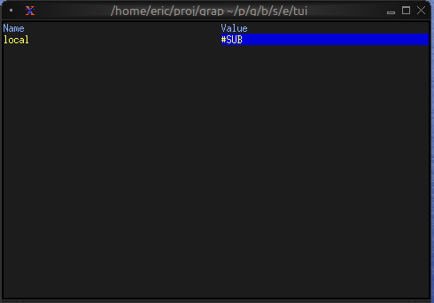
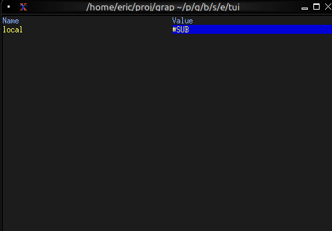

# The Browser Widget

The `browser` widget provides a specialized interface for browsing and interacting with netidx hierarchies. It displays netidx paths in a tree structure with keyboard navigation, selection, and cursor movement support.

## Interface

```graphix
{{#include ../../../../stdlib/graphix-package-tui/src/graphix/browser.gxi}}
```

## Parameters

<!-- CR claude for claude: [doc-drift/medium] This contradicts the code and browser.gxi.
The browser lists through `net::list_table(path)`, whose `#update` defaults to
`sys::time::timer(1, true)`, so the listing refreshes about once a second as well as on
a path change. A row published later appears within a second with no change of path.
Fix: say what browser.gxi says. While here, line 3's "tree structure" should be "a table
of one level's children", and `#rate` (the subscription throttle), `#flex` and the three
style parameters need bullets. probe:
design/review-2026-10-19/repro/book-ui-a-browser-listing-refresh.gx Also reported as
(gx-ui-04). (book-ui-a-01) -->
- **path** - The netidx path whose children are listed. The listing is fetched once each time `path` changes, so rows published later appear when the path next changes
- **cursor** - Programmatic cursor movement: `Left(n)`, `Right(n)`, `Up(n)`, `Down(n)`
- **selected_row** (output) - Full path of the selected row (e.g. `/t/r1`), null while the listing is empty
- **selected_path** (output) - Full path of the selected cell: the row in a list, the row and column in a table; null while the listing is empty
- **size** (input) - The area the browser is drawn in, which sizes its viewport; pass the enclosing block's `#size` output

## Examples

### Basic Usage

```graphix
{{#include ../../examples/tui/browser_basic.gx}}
```



### Basic Navigation

```graphix
{{#include ../../examples/tui/browser_navigation.gx}}
```



### Commands

A `:` command line beside the browser: `:w <value>` writes the value to
the selected path, and an error from the command shows in the bottom
title.

```graphix
{{#include ../../examples/tui/browser_commands.gx}}
```

## See Also

- [list](list.md) - For simpler selection interfaces
- [table](table.md) - For tabular data display
- [block](block.md) - For containing browsers with borders
