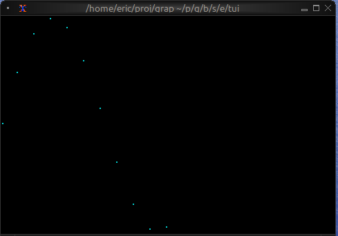
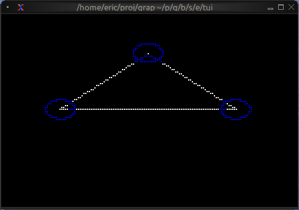
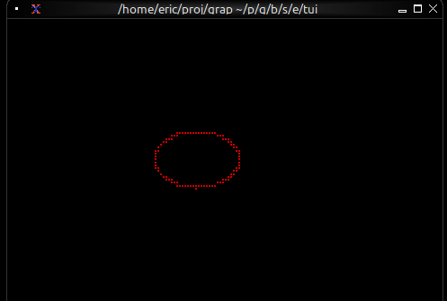

# The Canvas Widget

The `canvas` widget provides a low-level drawing surface for custom graphics. You can draw lines, circles, rectangles, points, and text labels at specific coordinates, making it perfect for diagrams, plots, and custom visualizations.

## Interface

```graphix
{{#include ../../../../stdlib/graphix-package-tui/src/graphix/canvas.gxi}}
```

## Parameters

- **background_color** - Background color for the canvas
- **marker** - Marker type, one of `Dot`, `Block`, `Bar`, `Braille`, `HalfBlock`, `Quadrant`, `Sextant`, `Octant`; `Braille` by default
- **x_bounds** - X-axis range with `min` and `max` fields (required)
- **y_bounds** - Y-axis range with `min` and `max` fields (required)

## Shape Types

### Line
```graphix
`Line({color: `Red, x1: 0.0, y1: 0.0, x2: 10.0, y2: 5.0})
```

### Circle
```graphix
`Circle({color: `Blue, x: 5.0, y: 5.0, radius: 2.0})
```

### Rectangle
```graphix
`Rectangle({color: `Green, x: 2.0, y: 2.0, width: 3.0, height: 4.0})
```

### Points
```graphix
`Points({color: `Yellow, coords: [(1.0, 1.0), (2.0, 3.0), (3.0, 1.5)]})
```

### Label
```graphix
`Label({line: line("Hello"), x: 5.0, y: 0.5})
```

## Examples

### Basic Usage

```graphix
{{#include ../../examples/tui/canvas_basic.gx}}
```


### Function Plotting

```graphix
{{#include ../../examples/tui/canvas_plot.gx}}
```



### Network Diagram

```graphix
{{#include ../../examples/tui/canvas_network.gx}}
```



### Animated Graphics

```graphix
{{#include ../../examples/tui/canvas_animated.gx}}
```



## Marker Comparison

- **Braille**: Highest resolution, smoothest curves, best for detailed graphics
- **Dot**: Fast rendering, lower resolution, good for simple shapes
- **Block**: High contrast, blocky appearance, good for filled areas

## Coordinate System

<!-- CR claude for claude: [doc-drift/low] The bottom-left corner is (x_bounds.min,
y_bounds.min), not (0, 0). This page's own canvas_plot example uses y bounds -1..1,
which puts (0, 0) at mid-left. State the corners in terms of the bounds. Found by
reading; not run. (book-ui-b-07) -->
- Origin (0, 0) is at the bottom-left
- X increases to the right
- Y increases upward
- Shapes outside bounds are clipped

## See Also

- [chart](chart.md) - For pre-built line charts
- [barchart](barchart.md) - For bar-based visualizations
