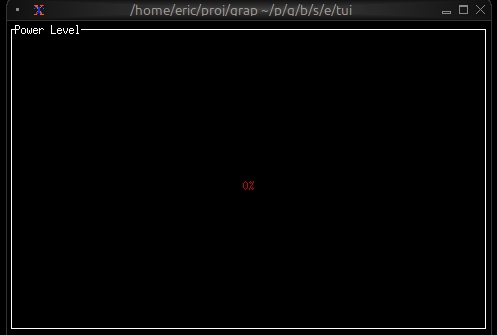

# The Gauge Widget

The `gauge` widget displays a single value as a filled progress indicator, perfect for showing percentages, completion status, or resource usage. It provides a clear visual representation of how full or complete something is.

## Interface

```graphix
{{#include ../../../../stdlib/graphix-package-tui/src/graphix/gauge.gxi}}
```

## Parameters

- **gauge_style** - Style for the filled portion
- **label** - A `Span` displayed in the center
- **use_unicode** - Use Unicode block characters for smoother rendering
- **style** - Style for the unfilled portion
- **ratio** (positional) - The filled fraction, from 0.0 to 1.0; a value outside that range is clamped, with a logged warning

## Examples

### Basic Usage

```graphix
{{#include ../../examples/tui/gauge_basic.gx}}
```


### Progress with Color Thresholds

```graphix
{{#include ../../examples/tui/gauge_threshold.gx}}
```



### Resource Usage

```graphix
{{#include ../../examples/tui/gauge_resource.gx}}
```


## See Also

- [linegauge](linegauge.md) - For horizontal line-based gauges
- [sparkline](sparkline.md) - For historical trend display
- [barchart](barchart.md) - For comparing multiple values
