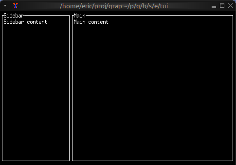
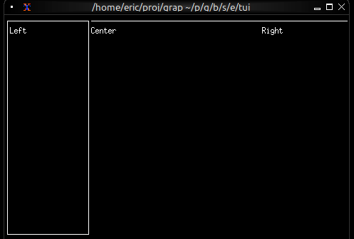
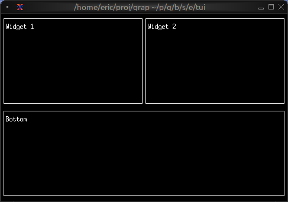
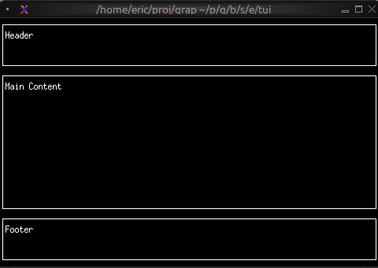

# The Layout Widget

The `layout` widget arranges child widgets in horizontal or vertical layouts with flexible sizing constraints. It's the primary tool for organizing complex TUI interfaces and supports focus management for interactive applications.

## Interface

```graphix
{{#include ../../../../stdlib/graphix-package-tui/src/graphix/layout.gxi}}
```

## Parameters

- **direction** - `Horizontal` or `Vertical` (default: `Vertical`)
- **focused** - Index of the currently focused child (0-indexed)
- **flex** - Alignment when children don't fill space: `Start`, `Center`, `End`, `SpaceAround`, `SpaceBetween`

## Constraint Types

- **Percentage(n)** - Allocates n% of available space
- **Length(n)** - Fixed width/height in cells
- **Min(n)** - At least n cells
- **Max(n)** - At most n cells
- **Ratio(num, den)** - Fractional allocation (num/den)
- **Fill(n)** - Takes remaining space after other constraints

## Examples

### Basic Layout

```graphix
{{#include ../../examples/tui/layout_basic.gx}}
```



### Three-Pane Layout with Focus

```graphix
{{#include ../../examples/tui/layout_focus.gx}}
```



### Nested Layouts

```graphix
{{#include ../../examples/tui/layout_nested.gx}}
```



### Header/Content/Footer

```graphix
{{#include ../../examples/tui/layout_header_footer.gx}}
```



### Nested Layout with Focus and Scrolling

Nested layouts whose focused pane is highlighted, with a long paragraph
scrolled beside a scrollbar.

```graphix
{{#include ../../examples/tui/layout_nested_focus.gx}}
```

## See Also

- [block](block.md) - Common child widget for layouts
<!-- CR claude for claude: [doc-drift/low] From ui/tui/, `../overview.md#input-handling`
resolves to ui/overview.md, which has no Input Handling heading, so the link lands at
the top of the generic UI overview. `input_handler` is documented in tui/input.md. Link
to `input.md`. (book-ui-b-08) -->
- [input_handler](../overview.md#input-handling) - For handling focus changes
