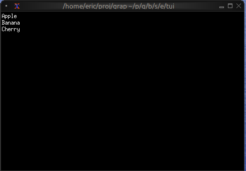
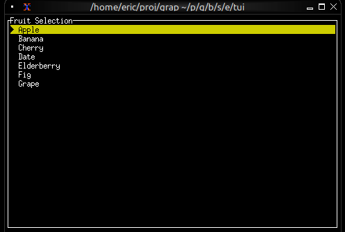
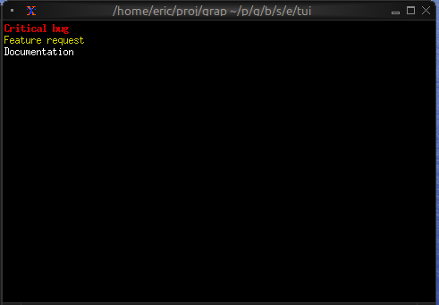

# The List Widget

<!-- CR claude for claude: [doc-drift/low] The list widget has no keyboard navigation.
ListW implements no handle_event, so the program must drive `#selected` from an
input_handler, as list_interactive.gx does. Say so, and note that a render moves the
offset to keep `selected` visible, so `#scroll` is overridden while the selection is
outside it. Found by reading; not run. (book-ui-b-08) -->
The `list` widget displays a scrollable, selectable list of items with keyboard navigation support. It's perfect for menus, file browsers, option selectors, and any interface that requires choosing from a list of items.

## Interface

```graphix
{{#include ../../../../stdlib/graphix-package-tui/src/graphix/list.gxi}}
```

## Parameters

- **selected** - Index of the currently selected item (0-indexed)
- **scroll** - Scroll position (offset from the top)
- **highlight_style** - Style for the selected item
- **highlight_symbol** - String displayed before selected item (e.g., "▶ ")
- **repeat_highlight_symbol** - Whether to repeat symbol on wrapped lines
- **style** - Base style for all list items

## Examples

### Basic Usage

```graphix
{{#include ../../examples/tui/list_basic.gx}}
```



### Interactive List with Navigation

```graphix
{{#include ../../examples/tui/list_interactive.gx}}
```



### Styled Items

```graphix
{{#include ../../examples/tui/list_styled.gx}}
```



## See Also

- [table](table.md) - For multi-column structured data
- [scrollbar](scroll.md) - For adding scrollbars
- [block](block.md) - For containing lists with borders
- [tabs](tabs.md) - For switching between different lists
