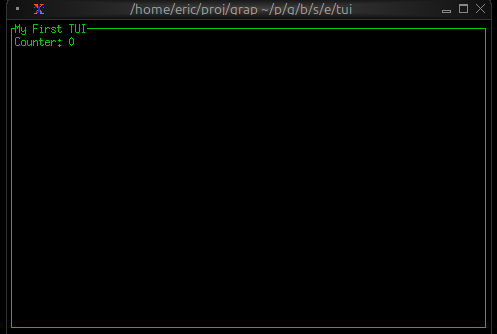

# Terminal User Interfaces (TUIs)

Graphix includes a comprehensive TUI library built on top of the popular Rust `ratatui` crate. This allows you to build rich, interactive terminal applications with:

### Core Components

The TUI library provides all the essential building blocks:

- **Layout**: Flexible container system with horizontal/vertical arrangement and various sizing constraints
- **Block**: Wrapper component that adds borders, titles, and styling to other components
- **Text**: Rich text rendering with styling, colors, and formatting
- **Paragraph**: Multi-line text with scrolling and word wrapping

### Interactive Widgets

<!-- CR claude for claude: [doc-drift/low] overview.md and input.md describe API the
code does not have. overview.md says Table is 'Sortable', but table has no sort
parameter. overview.md and calendar.md call calendar a 'Date picker', but it takes no
input. overview.md lists a layout 'Alignment' with Top/Center/Bottom, but layout has
only `flex`, and Alignment is Left/Center/Right. input.md gives `#handle: &fn(..) -> ..
throws 'e` and `-> Tui throws 'e`. The .gxi has no throws, and the checker refuses a
throwing handler. Failure: A handler using `?` written from input.md fails: `type
mismatch fn(e: Event) -> [`Continue, `Stop] does not contain fn(e: Event) -> [`Continue,
`Stop] throws Error<ErrChain<`Boom>>`. Fix: Drop 'Sortable' and 'Date picker', replace
the alignment bullet with the Flex variants, and copy input_handler's signature from
input_handler.gxi. Unverified: the reviewer's report, not checked by a verifier.
(examples-tui-10) -->
- **Table**: Selectable data tables with custom styling
- **List**: Scrollable lists with selection and highlighting
- **Tabs**: Tabbed interface for organizing content
- **Browser**: Netidx browser component
- **Calendar**: Month calendar with highlighted dates and events

### Data Visualization

- **Chart**: Line charts with multiple datasets, custom axes, and styling
- **Bar Chart**: Grouped and individual bar charts with labels
- **Sparkline**: Compact inline charts perfect for dashboards
- **Gauge**: Progress indicators and meters
- **Canvas**: Low-level drawing surface for custom graphics

### Input Handling

Interactive components wrap a widget in an `input_handler` to handle
UI events that flow through the widget graph from parent to child.
Parents can choose to pass on events they receive or not. See
[Input Handling](input.md) for details.

## Building Your First TUI

Here's a simple example that demonstrates the core concepts:

```graphix
{{#include ../../examples/tui/overview_first.gx}}
```

This creates a bordered block with a counter that increments every second. The key insight is that when `counter` changes, the text automatically updates because of Graphix's reactive nature.



## Styling and Theming

Graphix TUIs support rich styling with:

- **Colors**: Named colors (`Red`, `Green`, `Blue`), indexed colors (`Indexed(202)`), and RGB (`Rgb({r: 255, g: 100, b: 50})`)
- **Text Effects**: Bold, italic
- **Background Colors**: Set background colors for any component
- **Conditional Styling**: Use `select` expressions to change styles based on state

Many widgets take optional style arguments, allowing styling to be applied at many levels.

```graphix
{{#include ../../examples/tui/overview_styling.gx}}
```

## Layout System

The layout system provides flexible component arrangement:

- **Direction**: `Horizontal` or `Vertical`
- **Constraints**: `Percentage(50)`, `Length(20)`, `Min(10)`, `Max(100)`, `Ratio(1, 3)`, `Fill(1)`
- **Flex**: how leftover space is distributed: `Start`, `End`, `Center`, `SpaceBetween`, `SpaceEvenly`, `SpaceAround`
- **Focus Management**: Built-in focus handling for interactive components

```graphix
{{#include ../../examples/tui/overview_layout.gx}}
```

## State Management

In Graphix, UI state is just regular program state. Use variables to track:

- Selection states in lists and tables
- Input field contents
- Window/pane focus
- Application modes (normal, edit, command)

State changes automatically trigger UI updates:

```graphix
{{#include ../../examples/tui/overview_state.gx}}
```

## Real-time Data Integration

Graphix TUIs excel at displaying real-time data. Connect to data sources via netidx and the UI updates automatically:

```graphix
{{#include ../../examples/tui/overview_realtime.gx}}
```
