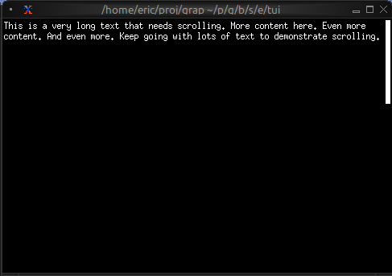
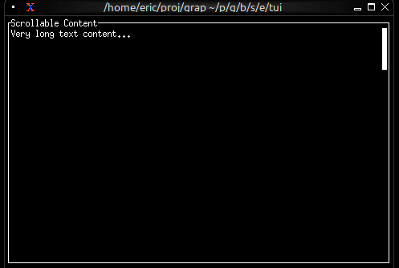
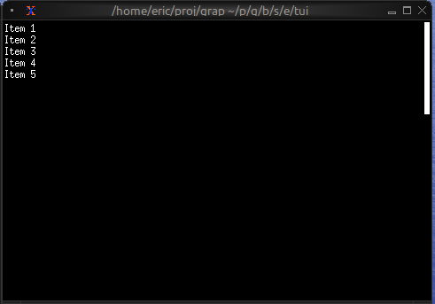

# The Scrollbar Widget

The `scrollbar` widget adds a visual scrollbar indicator to scrollable content, making it clear when content extends beyond the visible area and showing the current scroll position.

## Interface

```graphix
{{#include ../../../../stdlib/graphix-package-tui/src/graphix/scrollbar.gxi}}
```

## Parameters

- **position** - Current scroll position, typically the Y offset (default: 0)
- **content_length** - The number of scroll positions in the content; nothing measures the child, so a scrollbar without one draws no bar (default: 0)
- **viewport_length** - How many positions the view shows at once, which sizes the thumb (default: the bar's own length)
- **begin_symbol**, **end_symbol** - The arrows at each end; null, the default, draws none
- **track_symbol** - The track the thumb runs along; null, the default, draws none
- **thumb_symbol** - The thumb; null, the default, keeps ratatui's own
- **size** (output) - Rendered size of the scrollbar area

## Examples

### Basic Usage

```graphix
{{#include ../../examples/tui/scroll_basic.gx}}
```



### Scrollable Paragraph

```graphix
{{#include ../../examples/tui/scroll_paragraph.gx}}
```



### Scrollable List

```graphix
{{#include ../../examples/tui/scroll_list.gx}}
```




## See Also

- [paragraph](paragraph.md) - For scrollable text content
- [list](list.md) - For scrollable lists
- [table](table.md) - For scrollable tables
- [block](block.md) - For containing scrollable content
