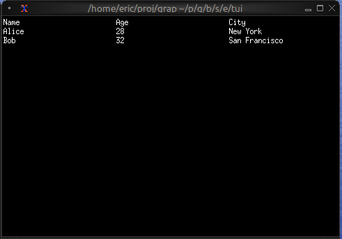
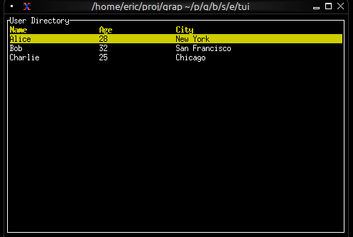
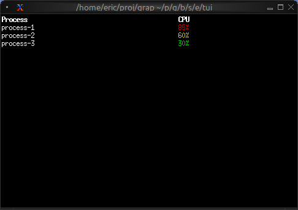
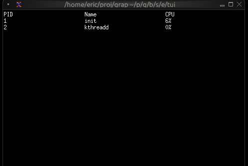

# The Table Widget

The `table` widget displays structured data in rows and columns with support for selection, scrolling, and custom styling. It's ideal for data grids, process monitors, file listings, and any tabular data display.

## Interface

```graphix
{{#include ../../../../stdlib/graphix-package-tui/src/graphix/table.gxi}}
```

## Parameters

- **rows** (positional) - The body rows, `&Array<&Row>`: a reference to an array of row references, so one row can change without rebuilding the others. Write `&[&row1, &row2]`, never `&[row1, row2]`. Build a row with `row(cells)` and a cell with `cell(line(..))`.
- **header** - Row shown above the body
- **footer** - Row shown below the body
- **widths** - Array of column width constraints
- **column_spacing** - Number of spaces between columns
- **flex** - How the columns share space the widths leave over: `` `Legacy ``, `` `Start ``, `` `End ``, `` `Center ``, `` `SpaceBetween ``, `` `SpaceEvenly ``, `` `SpaceAround ``
- **selected** - Index of the selected row
- **selected_column** - Index of the selected column
- **selected_cell** - The selected cell as `{x: column, y: row}`; it sets both the row and the column
- **row_highlight_style** - Style for the selected row
- **column_highlight_style** - Style for the selected column
- **cell_highlight_style** - Style for the selected cell
- **highlight_symbol** - String before the selected row
- **highlight_spacing** - When to show the highlight symbol: `` `Always ``, `` `WhenSelected ``, `` `Never ``
- **style** - Base style for the table

## Examples

### Basic Usage

```graphix
{{#include ../../examples/tui/table_basic.gx}}
```



### Interactive Table

```graphix
{{#include ../../examples/tui/table_interactive.gx}}
```



### Conditional Cell Styling

```graphix
{{#include ../../examples/tui/table_styled_cells.gx}}
```



### Real-time Updates

```graphix
{{#include ../../examples/tui/table_realtime.gx}}
```



## See Also

- [list](list.md) - For simpler single-column selection
- [scrollbar](scroll.md) - For adding scrollbars
- [block](block.md) - For containing tables with borders
